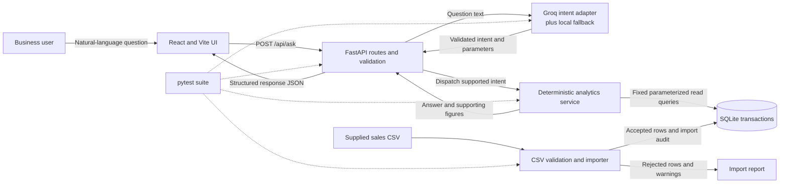
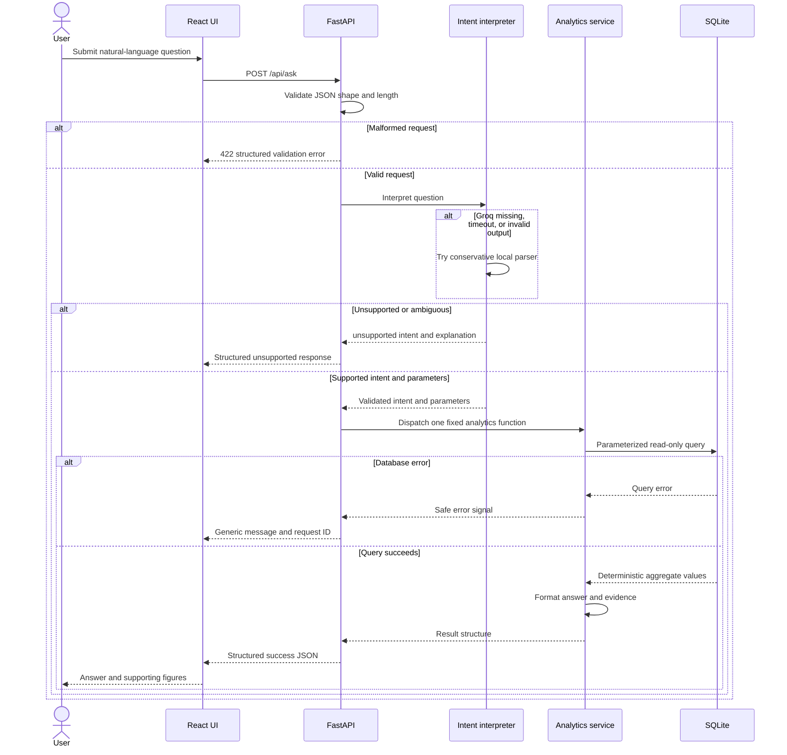

# Architecture

The application is a small local system with separate UI, API, interpretation, analytics, ingestion, and storage responsibilities. The LLM is an intent classifier only. It does not produce SQL or numeric results.

## System architecture

React calls the API and never accesses SQLite directly. Groq returns only a whitelisted intent and, for a comparison, two validated month parameters. Fixed analytics functions execute bound SQL parameters over a read-only connection. CSV import is a separate write path and replaces active records transactionally.

## Question-processing sequence

## Component boundaries

| Component | Responsibility |
|---|---|
| `frontend/src/App.jsx` | Question input, examples, request/loading/error states, answer and supporting-data display. |
| `backend/app/api.py` | HTTP routes, request validation, intent dispatch, and safe error responses. |
| `backend/app/interpreter.py` | Groq Chat Completions call, strict intent validation, and limited local fallback. |
| `backend/app/analytics.py` | Fixed SQL and deterministic business metrics. |
| `backend/app/importer.py` | CSV parsing, validation, rejection reports, and atomic dataset replacement. |
| `backend/app/database.py` | SQLite schema, indexes, foreign keys, and read-only/read-write connections. |
| `backend/tests/` | Deterministic importer, analytics, interpreter, API, and integration tests. |

## Main design choices

- **Intent classification instead of text-to-SQL:** keeps model output small, testable, and independent of database execution. Unsupported or malformed output is rejected.
- **Database is the numerical source of truth:** Groq selects a function; SQLite and application-owned formulas calculate all numbers.
- **Read-only analytics connection:** question answering cannot write to the database. SQL templates are application-owned and parameterized.
- **Integer minor units:** monetary sums avoid binary floating-point arithmetic; displayed amounts use two decimal places without assuming a currency symbol.
- **Transactional CSV replacement:** valid rows, rejected-row records, and import metadata are committed together, leaving the previous dataset intact if the replacement fails.
- **Local fallback:** common supported phrases work without Groq credentials. Ambiguous month comparisons require explicit years and unsupported questions return no numeric result.
